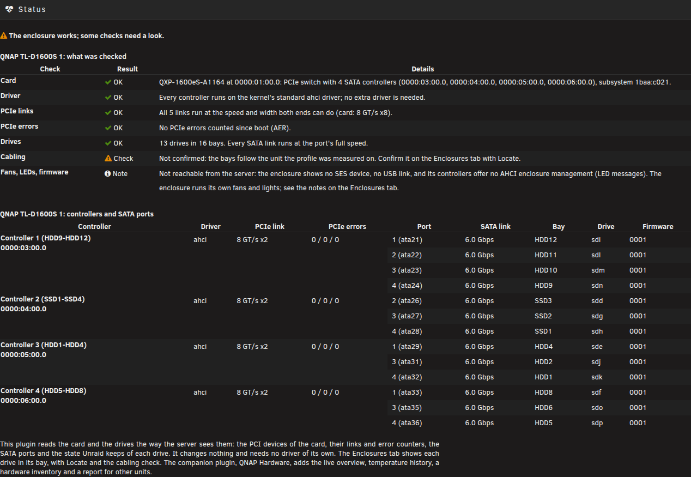
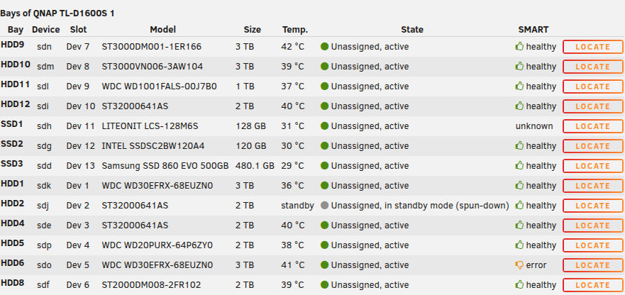
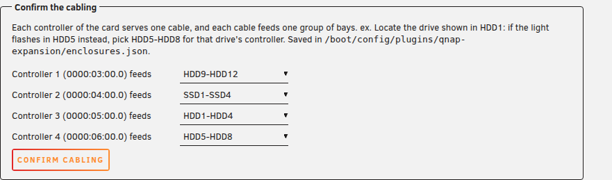

# QNAP Expansion: an Unraid plugin for the QNAP TL-D1600S JBOD enclosure

Checks the enclosure's QXP card, shows each drive in its bay, and finds a drive with Locate.

## Companion plugin

**[QNAP Hardware](https://github.com/luuvasara/unraid-qnap-hardware)** adds the live overview of the enclosure, bay labels on the Main page, temperature history, a hardware inventory with known issues and firmware, and a hardware report.
This plugin works on its own; both read the same enclosure profile and share the confirmed cabling.

## What it does

| | |
|---|---|
| Status | whether the card is found (PCI ids and QNAP subsystem), runs on the standard ahci driver, its PCIe links run at the speed and width both ends can do, its PCIe error counters, each drive's SATA link, and whether the cabling is confirmed |
| Enclosures | a drawing of the unit as it looks, front and rear, with the bays as labelled on it (HDD1-HDD12, SSD1-SSD4) with the drive in each bay, its Unraid slot, temperature, state and SMART health as Unraid last read them; no drive is woken |
| Locate | reads one drive for 20 seconds so its activity light flashes; it only reads, and asks first when the drive is in standby |
| Cabling | which controller of the card feeds which group of bays depends on how the four cables are plugged; confirm yours with Locate once, and every drive is shown in its bay |

No driver of its own, no daemon, nothing running in the background: the pages read the card and Unraid's own state when they are opened.

The enclosure runs its fans and lights itself; the server has no way to reach them (no SES device, no USB link, no enclosure management on the card's controllers), so this plugin does not control them and says so on the Status tab.

## Supported hardware

| Enclosure | Card | State |
|---|---|---|
| TL-D1600S | QXP-1600eS-A1164 (ASMedia switch, four ASM1164) | supported |
| TL-D1600S | QXP-1600eS (Marvell 88SE1475, before February 2022) | not supported: it needs QNAP's own driver |
| TL-D800S, TL-D400S | QXP-800eS-A1164, QXP-400eS-A1164 | not mapped yet: their QNAP controllers are listed on the Status tab; please send a report from QNAP Hardware's Report tab |
| TL-R1200S-RP, or two enclosures on one card | QXP-1600eS-A1164 | the card is found, but the bays carry TL-D1600S names: the server cannot tell which enclosure is cabled to the card |

## Screenshots

Taken in the offline test harness with made-up test data.

Status: the checks.

Enclosures: the bays with Locate.

Enclosures: confirming the cabling.

## Install

Unraid webGui: **Plugins, Install Plugin**, paste

    https://raw.githubusercontent.com/luuvasara/unraid-qnap-expansion/main/qnap-expansion.plg

The package is downloaded from `packages/` in this repository and checked against the MD5 in the `.plg`. The settings (the confirmed cabling) are kept on the flash drive in `/boot/config/plugins/qnap-expansion/`.

## Repository layout

| path | what |
|---|---|
| `qnap-expansion.plg` | the plugin manifest (version, package URL and MD5, install and remove, changes) |
| `src/` | the package tree: the Status tab and its checks |
| `kit/` | the shared plugin kit: About tab, install notes, build, and the enclosure layer (the TL-D1600S profile, the Enclosures tab, Locate) |
| `tests/` | `run-tests.sh`: the Status checks and the render test in headless Chrome |
| `packages/` | the built package of the version in the `.plg` |

Build on a workstation: `./build.sh` (bump the version in the `.plg` first), then `tests/run-tests.sh`.

## Licence

GPL-2.0, see [LICENSE](LICENSE).
